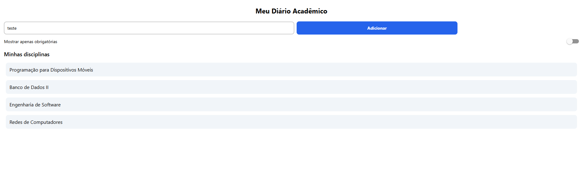

# MeuDiarioAcademico

Atividade 01 da disciplina de Programação para Dispositivos Móveis.

Tela de cadastro rápido de disciplinas do semestre, feita em React Native + Expo.

## Como criar o projeto

```
npx create-expo-app@latest MeuDiarioAcademico --template blank
```

Também precisa instalar:

```
npx expo install react-native-safe-area-context
```

## Como rodar

```
npx expo start
```

## O que tem no projeto

- `labels.js` — guarda os textos usados na tela (título, placeholder, etc.)
- `App.js` — tela principal com o layout, os componentes e os estilos

## Print da tela



