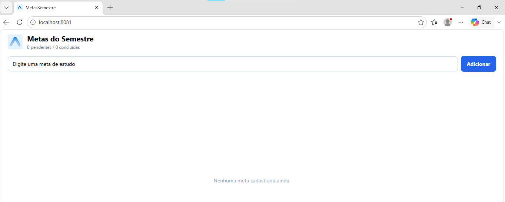
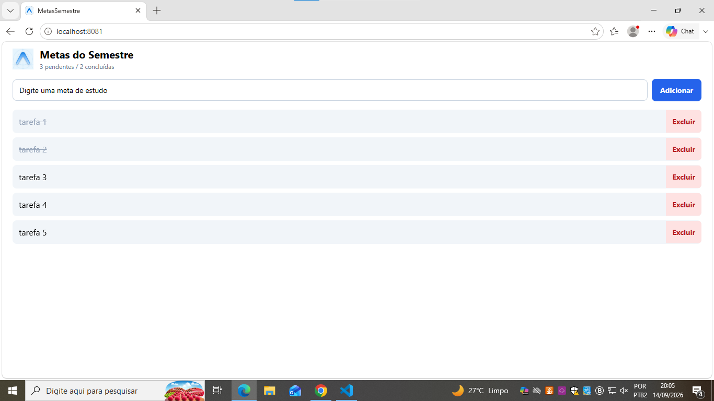

# MetasSemestre

ATIVIDADE 02 — Estado, Eventos, Componentização e Persistência

App de metas de estudo com persistência local.

## Criar o projeto

```
npx create-expo-app@latest MetasSemestre --template blank
```

```
npx expo install @react-native-async-storage/async-storage react-native-safe-area-context
```

## Rodar

```
npx expo start
```

## Arquivos

- `App.js` — estado das metas, validação, persistência
- `components/MetaInput.js` — input + botão de adicionar
- `components/MetaList.js` — lista com FlatList

## useEffect de carga e salvamento

Estão os dois no `App.js`.

O primeiro roda só uma vez quando o app abre, com `[]` de dependência, e busca as metas salvas no AsyncStorage.

O segundo roda toda vez que o array de metas muda, e salva a lista atualizada. Tem uma checagem pra não salvar um array vazio por cima dos dados antes da carga inicial terminar.

## Prints

Lista vazia:



Lista com itens:


Depois de fechar e abrir de novo:



