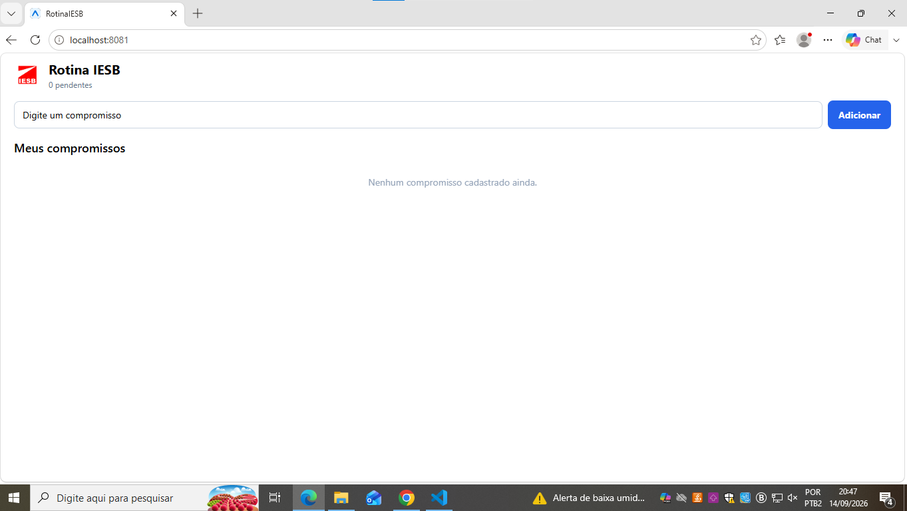
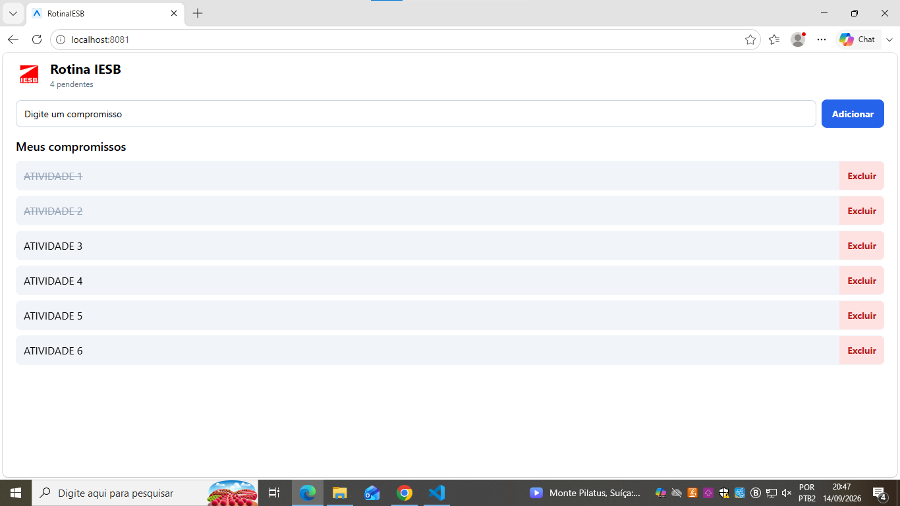
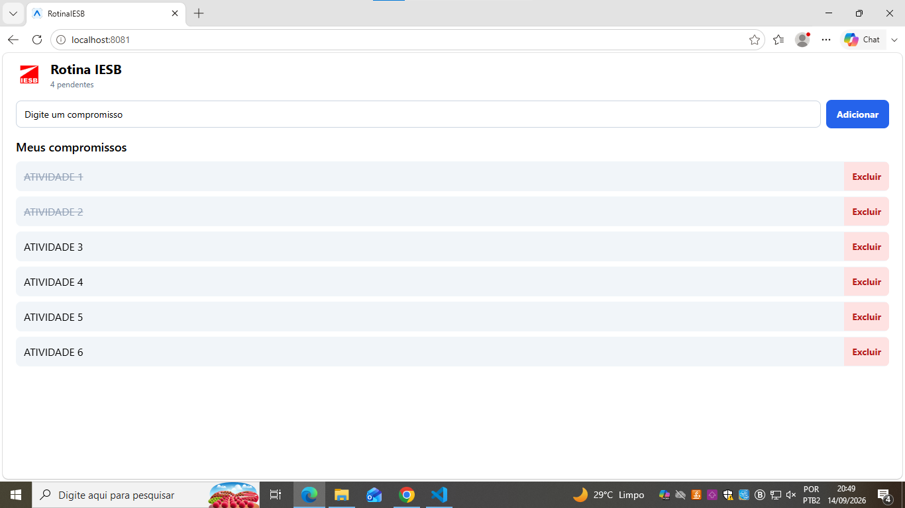

# RotinaIESB

Atividade integradora das aulas 02 a 06 da disciplina de Programação para Dispositivos Móveis.

App para organizar compromissos do dia (aula, estudo, trabalho, lazer), com persistência local.

## Criar o projeto

```
npx create-expo-app@latest RotinaIESB --template blank
```

```
npx expo install @react-native-async-storage/async-storage react-native-safe-area-context
```

## Rodar

```
npx expo start
```

## Arquivos criados

- `labels.js` — rótulos usados na tela (tituloApp, placeholderCompromisso, botaoAdicionar, tituloLista, listaVazia)
- `components/CompromissoInput.js` — campo de texto + botão de adicionar
- `components/CompromissoList.js` — lista de compromissos com FlatList

## useEffect de carga e salvamento

Os dois estão no `App.js`.

O de carga roda uma vez só, quando o app abre (`[]` de dependência), busca os dados salvos na chave `@rotina_iesb_compromissos` do AsyncStorage e faz o `JSON.parse`.

O de salvamento roda toda vez que a lista de compromissos muda, salva com `JSON.stringify`. Tem uma checagem pra não sobrescrever os dados com lista vazia antes da carga inicial terminar.

## Desafios opcionais feitos

- Marcar compromisso como concluído (toca no texto, risca e muda a cor)
- Contador no cabeçalho mostrando quantos estão pendentes

## Prints

Lista vazia:



Lista com itens:



Depois de fechar e abrir de novo:


